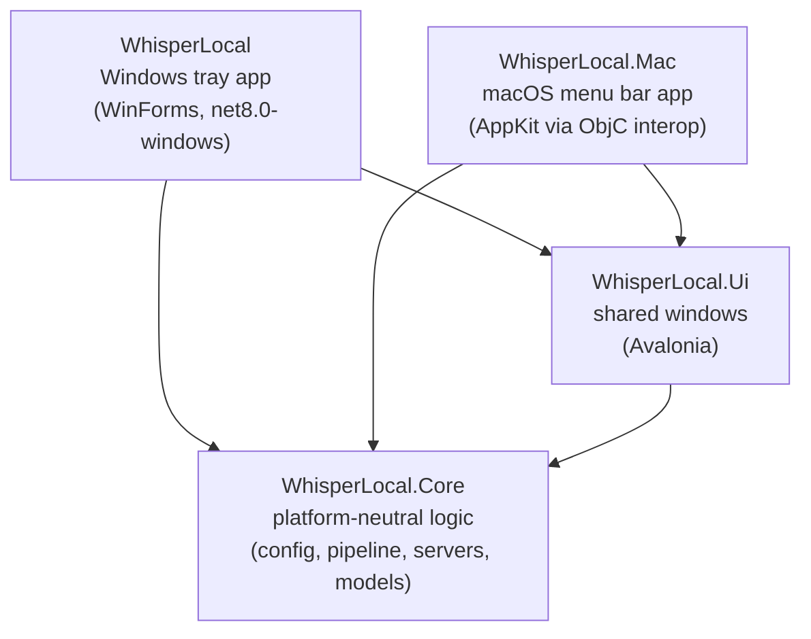

# Project structure

WhisperLocal is local push-to-talk dictation: hold a hotkey, speak, release, and the text is pasted into the
active app. Speech recognition runs on your machine (bundled whisper.cpp `whisper-server`); an optional local
language model (llama.cpp `llama-server`) proposes a grammar-checked version afterwards.

One solution (`WhisperLocal.sln`), four projects:

| Project | Role |
|---|---|
| `WhisperLocal.Core` | Everything that does not touch the OS UI: config, the dictation pipeline, the whisper/llama server processes, text filters, history and statistics, model downloads. |
| `WhisperLocal.Ui` | Cross-platform Avalonia windows (main window, history, statistics, transcript). The platform app plugs in through `IAppHost`. Used by both apps. |
| `WhisperLocal` | Windows app: tray icon, low-level keyboard hook, WASAPI recording, clipboard + Ctrl+V, WinForms indicator; hosts the shared windows on its WinForms message loop. |
| `WhisperLocal.Mac` | macOS app: menu bar item, CGEventTap hotkey, AudioQueue recording, pasteboard + Cmd+V, native floating panels, updater. |

Both platform apps produce an assembly named `WhisperLocal`, so Core's `internal` types are visible to them.

## How a dictation flows

1. **Hotkey down**: `KeyboardHook` (Windows) / `HotkeyTap` (macOS) fires; the tray app remembers the foreground
   app and starts recording (`AudioRecorder` / `MacAudioRecorder`). The indicator shows "Recording".
2. **Hotkey up**: recording stops and yields 16 kHz mono 16-bit PCM.
3. **Pipeline** (`DictationPipeline`): WAV → `WhisperServerStt` (starts `whisper-server` on demand) →
   `TextFilters` (hallucination removal, dictionary replacements) → optional `OllamaCleaner`.
4. **Insert**: `TextInserter` / `MacTextInserter` puts the text on the clipboard and sends Ctrl+V / Cmd+V to
   the remembered app. On macOS, if no text field is focused, the transcript window opens instead.
5. **After**: the indicator shows a summary; the dictation goes into `DictationHistory` and `DictationStats`;
   on macOS the optional grammar check (`Polisher`) proposes a polished version in `PolishPanel`.
6. **Idle**: after `Memory.IdleUnloadMinutes` without dictation, the servers are stopped to free memory.

## Files

### Repository root

| File | Note |
|---|---|
| `WhisperLocal.sln` | Solution with the four projects. |
| `README.md` / `README.uk.md` | User documentation in English and Ukrainian. |
| `CHANGELOG.md` | What changed, newest on top. |
| `.gitattributes` | Line endings: CRLF for C#/project files, LF for shell scripts and plists; binaries marked binary. |
| `.gitignore` | Build output, models, artifacts, the locally built macOS servers, editor files. |
| `.github/workflows/macos.yml` | CI ("Build"): builds the macOS DMG and the Windows zip on every push and PR, runs both self-tests, and on pushes to `main` (or `v*` tags) publishes one GitHub Release with both, which "Check for Updates" picks up. |
| `docs/PROJECT_STRUCTURE.md` | This file. |

### `WhisperLocal.Core` — shared logic

| File | Note |
|---|---|
| `WhisperLocal.Core.csproj` | net8.0 library; NAudio.Core for WAV handling. |
| `Log.cs` | Small thread-safe daily file logger (`Info`, `Warn`, `Error`, `Debug`). |
| `BatchRunner.cs` | `--batch <folder>` mode: runs recorded audio files through the pipeline and writes CSV/TXT reports, for comparing settings and models. |
| `Audio/AudioConvert.cs` | PCM conversions to the format Whisper wants (16 kHz mono 16-bit), WAV header, silence/level checks. |
| `Config/AppConfig.cs` | The whole `config.json` as classes: `Hotkey`, `Audio`, `Whisper`, `Memory`, `Filter`, `Llm`, `LocalLlm`, `Autocomplete` (shelved), `Polish`, `Insert`, `Ui`, `Logging`. |
| `Config/AppPaths.cs` | Where things live: next to the exe on Windows; `~/Library/Application Support/WhisperLocal` for config, logs and models on macOS. |
| `Config/ConfigManager.cs` | Loads `config.json` (with `//` comments), writes defaults on first run, hot-reloads on change and raises `Changed`. |
| `Config/ConfigEditor.cs` | Changes single values in `config.json` in place, keeping comments and formatting (used by the main window). |
| `Config/DefaultPrompts.cs` | Default system prompt for the Ollama cleanup step. |
| `Llm/OllamaCleaner.cs` | Optional transcript cleanup through a local Ollama server (`/api/chat`). |
| `Llm/LlamaServer.cs` | Runs bundled `llama-server` as a child process on demand and talks to its HTTP API; load/unload, memory use. |
| `Llm/LlmModels.cs` | Catalog of GGUF models offered in the main window (Gemma 3 4B/12B, Qwen 3 4B) with download links. |
| `Llm/Polisher.cs` | Grammar check: asks the language model for a corrected version of a finished dictation. |
| `Llm/Translator.cs` | Listening: translates one transcript segment with the language model; language names. |
| `Llm/Autocompleter.cs` | Autocomplete (shelved): continues the live transcript as plain text. |
| `Native/ChildProcessJob.cs` | Makes sure `whisper-server`/`llama-server` never outlive the app (Windows job object; pid file + cleanup elsewhere). |
| `Native/JobObjectMethods.cs` | P/Invoke declarations for the Windows job object API. |
| `Pipeline/DictationPipeline.cs` | Audio → speech-to-text → filters → optional LLM cleanup; returns the text and timings. |
| `Pipeline/DictationHistory.cs` | Last 1000 dictations with timings, in `history.jsonl`. |
| `Pipeline/DictationStats.cs` | Lifetime statistics (today / 7 days / all time) in `stats.json`. |
| `Pipeline/LiveAutocomplete.cs` | Autocomplete loop while the hotkey is held (shelved). |
| `Pipeline/LiveListener.cs` | Listening: cuts the system audio stream into segments at pauses, transcribes and optionally translates them. |
| `Pipeline/ListenNotes.cs` | Listening: the Markdown notes file of a session, written line by line. |
| `Stt/ISpeechToText.cs` | Speech-to-text interface: warm up, transcribe, unload. |
| `Stt/WhisperServerStt.cs` | Runs bundled `whisper-server` (Vulkan on Windows, Metal on macOS) on demand and transcribes over HTTP; language detection with an allowed list. |
| `Stt/WhisperModels.cs` | Catalog of Whisper models offered in the main window (Large v3, Large v3 Turbo). |
| `Stt/ModelDownloader.cs` | Downloads models from HuggingFace with resume and hash check. |
| `Stt/ModelNotFoundException.cs` | "Model missing" error whose message explains how to get it. |
| `Text/TextFilters.cs` | Removes typical Whisper hallucinations and applies the regex dictionary from the config. |
| `Text/TextDiff.cs` | Word-level diff, to highlight what the grammar check changed. |
| `Updates/GitHubReleases.cs` | "Check for Updates", shared part: the latest GitHub release, version comparison, download with checksum check. |

### `WhisperLocal.Ui` — shared windows (Avalonia)

| File | Note |
|---|---|
| `WhisperLocal.Ui.csproj` | net8.0 library; Avalonia 11. |
| `App.cs` | The Avalonia application; the platform app hooks in through `App.Started`. |
| `IAppHost.cs` | What the windows need from the platform app: config, history, setup checklist items, hotkey recording, load/unload, opening files. |
| `DarkTheme.cs` | Palette and building blocks (cards, labels, buttons, dropdowns, status dots). |
| `MainWindow.cs` | Main window: status header, setup checklist, hotkey and language, speech model and memory, grammar check and its model, last 3 dictations, file buttons. |
| `HistoryWindow.cs` | All kept dictations grouped by day, with averages. |
| `StatsWindow.cs` | Statistics tiles for today, 7 days, all time. |
| `TranscriptWindow.cs` | A dictation's text, editable, with Copy. |

### `WhisperLocal` — Windows app

| File | Note |
|---|---|
| `WhisperLocal.csproj` | WinForms exe (net8.0-windows); copies the bundled runtime and `config.json` next to the exe. |
| `config.json` | Default Windows config (the copy next to the exe is the one read). |
| `Program.cs` | Entry point: logging, `--batch`, `--self-test` (used by CI), single-instance mutex, config load, shared windows setup, runs `TrayApp`. |
| `TrayApp.cs` | The app: tray icon and menu, hotkey → record → pipeline → paste, history and statistics, model download, idle unload; implements `IAppHost` for the shared windows. |
| `Autostart.cs` | Start with Windows via the per-user Run registry key. |
| `Audio/AudioRecorder.cs` | WASAPI microphone capture, converted to 16 kHz mono on stop. |
| `Audio/AudioFile.cs` | Decodes audio files with Media Foundation (for `--batch`). |
| `Input/KeyboardHook.cs` | Push-to-talk hotkey via a low-level keyboard hook (single key or combination). |
| `Native/ForegroundApp.cs` | Snapshot of the foreground window and its process. |
| `Native/NativeMethods.cs` | Win32 P/Invoke declarations (hooks, input, windows, icons). |
| `Output/TextInserter.cs` | Clipboard + Ctrl+V into the remembered window, restoring the clipboard (`Insert.RestoreClipboard`). |
| `Ui/RecordingOverlay.cs` | Click-through "Recording / Processing" indicator at the bottom of the screen. |
| `Ui/TrayIcons.cs` | Tray icons drawn at runtime (waveform on a coloured square per state); also the windows' icon. |
| `Updates/Updater.cs` | "Check for Updates" on Windows: downloads the zip and, once the app has quit, copies it over the app folder (keeping `config.json`) and restarts. |
| `Ui/SharedUi.cs` | Sets up Avalonia without its own run loop, so the shared windows run on the WinForms message loop. |
| `Runtime/whisper/*` | Bundled whisper.cpp Vulkan build (`whisper-server.exe` and DLLs); `VERSION.md` says which version. |

### `WhisperLocal.Mac` — macOS app

| File | Note |
|---|---|
| `WhisperLocal.Mac.csproj` | net8.0 exe with Avalonia.Desktop; bundles icons, config and the built servers into the app. |
| `Info.plist` | App bundle metadata: menu bar app (no Dock icon), microphone usage text. |
| `config.json` | Default macOS config, installed to Application Support on first run. |
| `Program.cs` | Entry point: logging, `--self-test` (used by CI), `--batch`, single instance, starts Avalonia and `MenuBarApp`. |
| `MenuBarApp.cs` | The app: menu bar item, hotkey → record → pipeline → paste, indicator, grammar check, downloads, updates, idle unload; implements `IAppHost` for the shared windows. |
| `LaunchAgent.cs` | Start at login via `~/Library/LaunchAgents`. |
| `Audio/MacAudioRecorder.cs` | AudioQueue microphone capture straight to 16 kHz mono PCM; microphone permission state. |
| `Audio/SystemAudioTap.cs` | Listening: captures what the Mac plays through a Core Audio process tap (macOS 14.2+), as 16 kHz mono PCM. |
| `Audio/MacAudioFile.cs` | Decodes audio files with `afconvert` (for `--batch`). |
| `Input/HotkeyTap.cs` | Push-to-talk hotkey via CGEventTap (needs Accessibility); also records new hotkeys for the main window. |
| `Interop/ObjC.cs` | Minimal Objective-C runtime bindings: classes, selectors, typed `objc_msgSend`, strings, autorelease pools. |
| `Interop/MacNative.cs` | C APIs: CoreFoundation, CoreGraphics events, Accessibility, AudioToolbox. |
| `Output/MacTextInserter.cs` | Pasteboard + Cmd+V into the frontmost app, restoring the pasteboard (`Insert.RestoreClipboard`); undo + paste for the grammar check. |
| `Output/FocusedInput.cs` | Asks Accessibility whether a text field is focused (otherwise the transcript window opens). |
| `Output/FrontmostApp.cs` | Snapshot of the frontmost app (pid, name, bundle id). |
| `Ui/StatusMenu.cs` | The menu bar item (NSStatusItem), its menu and state icons. |
| `Ui/Hud.cs` | Shared setup for the floating panels: non-activating, on every desktop and over full-screen apps; logs when macOS keeps one hidden. |
| `Ui/RecordingOverlay.cs` | Indicator at the bottom: live seconds while recording/processing, then a summary with a Text button; a fresh panel per dictation. |
| `Ui/PolishPanel.cs` | Grammar check proposal with changed words highlighted; insert, copy or close. |
| `Ui/ListenPanel.cs` | Listening indicator: elapsed time, the last lines with their translations side by side, the sentence being spoken greyed, language menu, notes and stop buttons. |
| `Ui/AutocompletePanel.cs` | Ghost-text panel for autocomplete (shelved). |
| `Ui/ActionTarget.cs` | One Objective-C object that receives menu and button clicks and dispatches them by tag. |
| `Ui/Dialogs.cs` | Native alerts, notifications and opening files/URLs. |
| `Updates/Updater.cs` | "Check for Updates" on macOS: downloads the DMG, verifies its signer, replaces the app and restarts. |
| `Resources/*` | App icon (`AppIcon.icns`) and menu bar icons per state. |

### `scripts`

| File | Note |
|---|---|
| `build-mac.sh` | Builds whisper-server and llama-server with Metal, publishes the app, assembles and signs `WhisperLocal.app`; `--install`, `--dmg`. |
| `get-model.sh` / `get-model.ps1` | Download a Whisper model with hash check (macOS / Windows). |
| `make-mac-icons.py` | Generates the macOS app and menu bar icons from the tray icon design. |

## Where things are stored at runtime

| | Windows | macOS |
|---|---|---|
| Config | `config.json` next to the exe | `~/Library/Application Support/WhisperLocal/config.json` |
| Logs | `logs\` next to the exe | `.../WhisperLocal/logs/` |
| Models | `models\` next to the exe | `.../WhisperLocal/models/` |
| History, statistics | `history.jsonl`, `stats.json` next to the exe | `.../WhisperLocal/history.jsonl`, `stats.json` |
| whisper-server | `whisper\` next to the exe | inside `WhisperLocal.app` |
